# 🗃️ Veri Modeli ve Modüller Arası İlişkiler (ER Şeması)

> **Kapsam:** Tüm `src/Modules/` domain aggregate root'larının kimlik (Guid) ve modüller arası referans alanları.
> **Yöntem:** Mevcut varlıklar koddan doğrulanmıştır (`<Module>/Domain/<Module>DomainModel.cs`); promp.txt vizyonuyla gelen
> yeni varlıklar **⚠️ Önerilen (henüz kodda yok)** olarak işaretlidir.
> **Güncelleme:** 2026-11-15 (P17 T3: oluşum anahtarı, filtreli benzersizlik ve katılım makbuzu) · 2026-09-05 (P13 Task 5/E-07: `identity` şemasına `AccountDeletionRequest`/`account_deletion_requests` — `UserAccountId`, `RequestedOnUtc`, `ScheduledForUtc` (+30 gün), `Status` (Pending/Cancelled/Completed); migration `AddAccountDeletionRequests`. Silme uygulanınca **satırlar silinmez**, kişisel alanlar üzerine yazılır — ders/ödeme referansları korunur) · 2026-09-04 (P06/M06-3+M06-4: `Assignment`'a `Score` `int?` + `GradedOnUtc` `timestamptz?` (puanlama) ve `DueSoonNotifiedOnUtc`/`MissedNotifiedOnUtc` `timestamptz?` (son teslim uyarısı idempotency damgaları) + `(Status, DueDateUtc)` indeksi; migration `AddAssignmentGradeAndDueTracking`) · 2026-09-04 (P06/M07-1: `PaymentRecord`'a `OverdueMarkedOnUtc` `timestamptz?` — kalıcı gecikme işaretinin anı; migration `AddOverdueTracking`) · 2026-09-04 (P06/M05-1+M05-4: `LessonSession`'a `MeetingUrl`/`RecordingUrl`/`CancellationReason` — migration `AddSessionLifecycleFields`) · 2026-09-04 (P06/M02-4: `TeacherProfile`'a `IsActive` bool alanı — arama görünürlüğü; migration `AddTeacherIsActive`) · 2026-09-03 (P04/M06-1: Assignments şemasına `LessonResource`/`lesson_resources` + `LessonResourceKind`) · 2026-09-03 (P04: `TeacherProfile.ProfilePhotoUrl` → `ProfilePhotoKey` (IFileStorage anahtari); `Assignment`'a `AttachmentStorageKey`/`AttachmentFileName`/`AttachmentContentType`/`AttachmentSizeBytes`) · 2026-09-03 (P03/M11-3: Notifications şemasına `UserNotification`/`user_notifications` + `UserNotificationKind` enum'u; `LessonReminder`'a `AttemptCount`/`LastError` + `ReminderStatus.Failed`) · 2026-09-03 (P03/M11-2: `DeviceToken`/`device_tokens` + `DevicePlatform` enum'u) · 2026-08-26 (Y4 kapatıldı: ortak `InboxMessage`/`inbox_messages` — 12 modül şemasında `(EventId,Handler)` composite PK — eklendi; ProgressTracking'in `processed_events`'i ve Parents'ın `processed_integration_events`'i kaldırıldı; Notifications'ın `processed_integration_events`'i yalnız haftalık-özet dedup'a daraltıldı) · 2026-08-20 (kod-drift düzeltmesi: Parents enum adı `ParentNotificationChannel` — `NotificationChannel` değil; Notifications'ın `NotificationChannel`'ından farklı tip/isim olduğu açıklığa kavuşturuldu) · 2026-08-19 (m01–m06 kod-senkron: `StudyScheduleEntryStatus` enum kaldırıldı — kodda yok; `LessonSchedule` `TeacherUserId?`/`Topic`/`ColorHex` Ç-06 alanları)
>
> İlgili: [`00_genel_bakis.md`](00_genel_bakis.md) · [`mimari_inceleme.md`](mimari_inceleme.md) · [`../INDEX.md`](../INDEX.md)

---

## 1. Modül Sınırı Kuralı (Önemli)

> Her modül **kendi şemasında** ayrı `DbContext` ile yaşar (`identity`, `teachers`, `students`, ...). Aşağıdaki "→" referansları
> **veritabanı FK'sı DEĞİLDİR** — modüller arası doğrudan DB erişimi yasaktır. Bunlar **mantıksal referanslardır**: bir modül
> başka modülün entity `Id`'sini `Guid` olarak saklar; senkronizasyon integration event / application service ile sağlanır
> (bkz. [`mimari_inceleme.md`](mimari_inceleme.md) O5 — read-model mekanizması yeni modüller için önkoşul).

---

> **Ortak tüketici idempotency tablosu (`inbox_messages`, 2026-08-26):** `OutboxMessage`'ın kardeşi — 12 modül şemasının
> (Identity, Teachers, Students, Scheduling, LessonSessions, Assignments, Payments, Notifications, Parents, Settings, Study,
> ProgressTracking) her birinde aynı yapıda bulunur. Alanlar: `EventId` (Guid), `Handler` (string, handler tip adı),
> `EventName` (string), `ProcessedOnUtc` (DateTime) — **composite PK `(EventId, Handler)`** (tek event birden çok handler
> tarafından tüketilebilir). Ortak `IdempotentIntegrationEventHandler` taban sınıfı tarafından yazılır: iş yazımı + inbox-işaretleme
> tek transaction'da atomik commit edilir (bkz. [`mimari_inceleme.md`](mimari_inceleme.md) Y4). Bu, eski modül-bazlı dedup
> tablolarının yerini alır: ProgressTracking'in `processed_events`'i ve Parents'ın `processed_integration_events`'i
> **kaldırıldı**; Notifications'ın `processed_integration_events`'i yalnızca `ParentWeeklySummaryService` haftalık-özet
> dedup'ı için **korundu** (event idempotency'siyle ilgisiz, ayrı bir amaç).

---

> **Ortak arka plan işi kirası (`job_leases`, 2026-09-05 / A-07):** 15 modül şemasının her birinde bulunur.
> Alanlar: `JobName` (string, **PK**), `OwnerId` (Guid — uygulama örneği), `AcquiredOnUtc`, `ExpiresOnUtc`.
> Zamanlayıcıyla koşan modül işleri (`notification-dispatch`, `payment-overdue-scan`, `assignment-due-scan`,
> `progress-snapshot`, `parent-weekly-summary`, `outgoing-email-dispatch`, P15 T8'den beri `account-deletion` ve
> `data-retention`) her turdan önce kirayı `INSERT … ON CONFLICT DO UPDATE … WHERE "ExpiresOnUtc" <= now OR
> "OwnerId" = EXCLUDED."OwnerId"` ile alır: iki uygulama örneği aynı anda denerse yalnız biri satır günceller;
> **sahip her turda yeniler** (N-41 — eski koşulda sahip kendi kirasına takılıyordu). Süresi dolmuş kira başka
> örnekçe devralınabilir (çöken örnek işi kalıcı kilitlemez). Ayrıntı: `../architecture/backend.md` §7.3.
> **Neden Redis değil veritabanı:** Redis'e bağlı korumaların hepsi fail-open'dır (ADR-0004); Redis
> düştüğünde kilit "alınmış" sayılıp iş yine koşar ve çift bildirim tam da o an üretilirdi.
> Bkz. [`mimari_inceleme.md`](mimari_inceleme.md) A-07.

---

> **Ortak e-posta kuyruğu (`outgoing_emails`, 2026-09-05 / A-04):** 15 modül şemasının her birinde bulunur;
> `OutboxMessage`'ın e-posta karşılığıdır. Alanlar: `Id` (PK), `ToEmail`, `Subject`, `HtmlBody`, `TextBody`,
> `CreatedOnUtc`, `SentOnUtc?`, `RetryCount`, `NextAttemptUtc?`, `Error?`, `DeadLetteredOnUtc?`.
> Kısmi indeks `ix_outgoing_emails_pending (NextAttemptUtc, CreatedOnUtc) WHERE SentOnUtc IS NULL AND
> DeadLetteredOnUtc IS NULL`. Kayıt, iş yazımıyla **aynı transaction'da** eklenir (`IEmailQueue.Enqueue`
> SaveChanges çağırmaz); gönderimi `OutgoingEmailDispatcher` üstlenir. Gönderilmiş satırlar retention ile
> budanır — gövdeleri doğrulama/sıfırlama token'ı taşır, saklama süresi sınırlı olmalıdır.
> Bkz. [`mimari_inceleme.md`](mimari_inceleme.md) A-04.

## 2. Merkezi Referanslar (Hub'lar)

- **`Identity.UserAccount.Id`** → öğretmen/öğrenci/veli kullanıcılarının kök kimliği. Çoğu modül `*UserId` ile bağlanır.
- **`Students.StudentProfile.Id`** → ders, ödev, ödeme, hatırlatma hep bir öğrenciye iliştirilir.

> ⚠️ **Asimetri:** Öğretmen tarafı `TeacherUserId` (Identity `UserAccount.Id`) ile; öğrenci tarafı `StudentId`
> (`StudentProfile.Id`, Identity değil) ile referanslanır. Yeni modül yazarken dikkat.
>
> 🔀 **Profil birleştirme (Ö-C/B5):** İki `StudentProfile` birleştiğinde (öğrenci davet kodunu girip claim yapar ve zaten
> bir self-profil'i varsa), kanonik = self-profil olur; manuel profil `IsMerged=true` + `MergedIntoStudentId` ile pasifleşir.
> `Students`, `StudentProfilesMergedDomainEvent(FromStudentId, ToStudentId)`'ı Outbox ile yayar; **`StudentId` hub'ına bağlı
> tüm modüller** (Scheduling, Assignments, Payments, LessonSessions, Study; P15 T3'ten beri Parents ve ProgressTracking,
> P15 T5'ten beri Messaging) kendi kayıtlarındaki `StudentId=FromStudentId`
> satırlarını kanonik `ToStudentId`'ye yeniden atar (`ExecuteUpdateAsync`; `Study.StudyStudent` PK=StudentId olduğundan kaynak
> satır silinir). Benzersiz anahtarlı tablolarda (Parents `known_students`/özet, ProgressTracking hâkimiyet/fotoğraf,
> Messaging `(TeacherUserId, CounterpartUserId, StudentId)`) çakışmayan satır taşınır, çakışanda kanonik kazanır — Messaging'de
> kaynak sohbetin mesajları kanonik sohbete katılır ve kopya silinir. Reporting, Notifications ve Identity birleşmeyi henüz
> tüketmiyor (ILERLEME #189). Böylece veli paneli tek kanonik `StudentId`'den beslenir. Sözleşme: `Shared.Contracts.StudentProfilesMergedIntegrationEvent`.

---

## 3. ER Diyagramı (Mantıksal — 🟢 mevcut + ⚠️ önerilen)

```mermaid
erDiagram
    UserAccount ||--o{ UserRoleMembership : has
    UserAccount ||--o{ RefreshTokenSession : has
    UserAccount ||--o{ UserSecurityToken : has
    UserAccount ||--o{ AccountDeletionRequest : "E-07 hesap silme talebi"

    UserAccount ||--o| TeacherProfile : "UserId"
    UserAccount ||--o| StudentProfile : "UserId (self)"
    UserAccount ||--o{ StudentProfile : "CreatedByTeacherUserId"
    UserAccount ||--o{ StudentProfile : "ParentUserId"
    UserAccount ||--o{ TeacherStudentLink : "TeacherUserId (çoklu öğretmen, B-06)"
    UserAccount ||--o| UserSetting : "UserId"
    UserAccount ||--o| ParentProfile : "UserId"
    UserAccount ||--o{ ParentChildLink : "ParentUserId"
    UserAccount ||--o| UserSubscription : "UserId (önerilen)"

    TeacherProfile ||--o{ TeacherAvailabilitySlot : has
    TeacherProfile ||--o{ TeacherSubject : has
    TeacherProfile ||--o{ TeacherCertificate : has
    StudentProfile ||--o{ StudentSubject : has
    StudentProfile ||--o| StudentProfile : "MergedIntoStudentId (Ö-C merge → kanonik)"
    StudentProfile ||--o{ TeacherStudentLink : "StudentId (çoklu öğretmen)"
    ParentProfile ||--o{ ParentChildLink : "onaylı bağ"
    StudentProfile ||--o{ ParentChildLink : "StudentId"
    StudentProfile ||--o| ChildProgressSnapshot : "StudentId (read-model)"
    StudentProfile ||--o| KnownStudent : "StudentId→UserId (read-model)"

    StudentProfile ||--o{ LessonSchedule : "StudentId"
    StudentProfile ||--o{ LessonSchedule : "StudentId (öğretmen dersi + Ç-06 kendi dersi: TeacherUserId null)"
    StudentProfile ||--o{ LessonSession : "StudentId"
    StudentProfile ||--o{ Assignment : "StudentId"
    StudentProfile ||--o{ LessonNote : "StudentId"
    StudentProfile ||--o{ PaymentRecord : "StudentId"
    StudentProfile ||--o{ LessonReminder : "StudentId"
    StudentProfile ||--o{ StudySession : "StudentId (önerilen)"
    StudentProfile ||--o{ TestResult : "StudentId (önerilen)"
    StudentProfile ||--o{ MockExam : "StudentId (çok dersli deneme)"
    MockExam ||--o{ TestResult : "MockExamId (ders satırı)"
    StudentProfile ||--o{ TopicMastery : "StudentId (önerilen)"

    LessonSchedule ||--o{ LessonSession : "LessonScheduleId"
    LessonSchedule ||--o| LessonReminder : "LessonScheduleId"
    LessonSchedule ||--o{ LessonOccurrenceException : "SeriesLessonScheduleId (tekrar istisnası, B-03)"
    LessonSchedule ||--o{ LessonChangeRequest : "LessonScheduleId (öğrenci erteleme talebi, Ö-F)"
    UserAccount ||--o{ TimeOffBlock : "TeacherUserId (tatil bloğu, B-01)"

    LessonSession ||--o{ Assignment : "LessonSessionId"
    LessonSession ||--o| LessonNote : "LessonSessionId"
    LessonSession ||--o{ PaymentRecord : "RelatedLessonSessionId"
    Assignment ||--o{ AssignmentSubmission : "öğrenci yükleme (önerilen)"

    Conversation ||--o{ ConversationParticipant : "önerilen"
    Conversation ||--o{ Message : "önerilen"
    SubscriptionPlan ||--o{ UserSubscription : "önerilen"
```

---

> **P17 T3:** `progress_tracking.lesson_attendance_receipts` kalıcı katılım makbuzu: `LessonSessionId uuid` birincil anahtar (M05’e mantıksal referans, çapraz-modül FK yok) + `AppliedOnUtc timestamptz`. `LessonAttendanceReceipts` migration’ı tabloyu kurar. M05 `OccurrenceKeyedSessions` nullable anahtarı geri doldurur, en erken kayıt dışındaki tekrarları iptal edip NULL anahtar yapar; veri silinmez.

## 4. Aggregate Root'lar — 🟢 Mevcut (Koddan)

> Yalnız kimlik + ilişki alanları; tüm alanlar için ilgili modül doc'una bakın.

| Modül (şema) | Aggregate / Entity | Kimlik | Referanslar | Doc |
|--------------|--------------------|--------|-------------|-----|
| Identity (`identity`) | `UserAccount` | `Id` | — (kök) | [m01](m01_identity.md) |
| | `UserRoleMembership` / `RefreshTokenSession` / `UserSecurityToken` | `Id` | `UserAccountId` → UserAccount | `RefreshTokenSession.RevocationReason` (metin, nullable — P15 T7) |
| | `AccountDeletionRequest` | `Id` | `UserAccountId` → UserAccount | Kısmi UNIQUE `IX_account_deletion_requests_UserAccountId_pending` (`"Status" = 'Pending'`) — P15 T7 |
| Teachers (`teachers`) | `TeacherProfile` | `Id` | `UserId` → UserAccount | `IsActive` (varsayılan `true`, P06/M02-4): pasif profil aramada dönmez, satır silinmez · [m02](m02_teachers.md) |
| | `TeacherAvailabilitySlot` | `Id` | `TeacherProfileId` → TeacherProfile | |
| | `TeacherSubject` | `Id` | `TeacherProfileId` → TeacherProfile | çoklu branş (birincil `Subject` korunur) |
| | `TeacherCertificate` | `Id` | `TeacherProfileId` → TeacherProfile | sertifika/deneyim |
| Students (`students`) | `StudentProfile` (+`DateOfBirth` doğum tarihi `date?` — Veli V-A 2026-07-19; +`MembershipTier` Free/Premium üyelik — Ö-D 2026-07-19, **LEGACY** P09 Task 2'den beri karar kaynağı değil, P12'de silinecek; `IsMerged`/`MergedIntoStudentId` profil birleştirme — Ö-C 2026-07-19; `TargetExam` hedef sınav S-03.9 — Ö-B 2026-07-19; `LinkUser` davranışı — B-06 2026-07-18) | `Id` | `UserId?`, `CreatedByTeacherUserId?`, `ParentUserId?` → UserAccount · `MergedIntoStudentId?` → StudentProfile (kanonik) | [m03](m03_students.md) |
| | `StudentSubject` | `Id` | `StudentProfileId` → StudentProfile | |
| | `TeacherStudentLink` (+`InviteCode` davet kodu/claim — Ö-C 2026-07-19; çoklu öğretmen bağı, free limit=5, arşiv, öğrenci bazlı ücret — Dilim C 2026-07-18) | `Id` | `TeacherUserId` → UserAccount · `StudentId` → StudentProfile · `InviteTargetUserId?` · `InviteCode?` (indexli) · UNIQUE `(TeacherUserId,StudentId)` | [m03](m03_students.md) |
| Scheduling (`scheduling`) | `LessonSchedule` (+`MeetingUrl`, `OriginalStartAtUtc`, `RescheduleNote`, `CancellationReason`, `IsChargeable` — 2026-07-18; +`Topic`/`ColorHex`, `TeacherUserId`/`LessonFormat` nullable — Ç-06 2026-07-19) | `Id` | `TeacherUserId?` → UserAccount (Ç-06: self derste null) · `StudentId` → StudentProfile | [m04](m04_scheduling.md) |
| | ~~`StudyScheduleEntry`~~ **kaldırıldı (Ç-06, 2026-07-19)** → birleşik `LessonSchedule` (`TeacherUserId` null = kendi ders; +`Topic`/`ColorHex`). Migration `UnifyLessonSchedule` (veri göçü + tablo drop) | — | — | [m04](m04_scheduling.md) |
| | `TimeOffBlock` (tatil/müsait değil bloğu, B-01 2026-07-18) | `Id` | `TeacherUserId` → UserAccount | [m04](m04_scheduling.md) |
| | `LessonOccurrenceException` (tekrar oturum istisnası, B-03 2026-07-18; `Entity<Guid>`) | `Id` | `SeriesLessonScheduleId` → LessonSchedule · **UNIQUE `(SeriesLessonScheduleId, OriginalStartAtUtc)`** — bir oluşuma tek istisna, yazma upsert (P16 T3 / N-05) | [m04](m04_scheduling.md) |
| | `LessonChangeRequest` (öğrenci ders erteleme talebi, Ö-F 2026-07-18; **P17 T1:** `OccurrenceStartAtUtc` — ertelenecek oluşumun orijinal başlangıcı, tekrarlı derste zorunlu, eski tekrarlı talepte NULL) | `Id` | `LessonScheduleId` → LessonSchedule · `StudentId` → StudentProfile · `TeacherUserId` → UserAccount | [m04](m04_scheduling.md) |
| LessonSessions (`lesson_sessions`) | `LessonSession` (+`IsChargeable`; P17 T3: `OccurrenceStartUtc timestamptz?`, UNIQUE `(LessonScheduleId, OccurrenceStartUtc)` WHERE `LessonScheduleId IS NOT NULL`) | `Id` | `LessonScheduleId?` → LessonSchedule · `TeacherUserId` · `StudentId` | [m05](m05_lesson_sessions.md) |
| Assignments (`assignments`) | `Assignment` (+`TeacherFeedback` — T-06.7/8 2026-07-18; +`Score`/`GradedOnUtc` — M06-4 2026-09-04; +`DueSoonNotifiedOnUtc`/`MissedNotifiedOnUtc` — M06-3 2026-09-04) | `Id` | `StudentId` · `TeacherUserId` · `LessonSessionId?` | [m06](m06_assignments.md) |
| | `LessonNote` (+`Visibility` — B-05 2026-07-18) | `Id` | `LessonSessionId` · `TeacherUserId` · `StudentId` | |
| | `LessonResource` (ders kaynağı — dosya/bağlantı, M06-1 2026-09-03; `(TeacherUserId,IsActive)` + `(StudentId,IsActive)` indeksli, yumuşak silme) | `Id` | `TeacherUserId` · `StudentId?` (null = tüm öğrencilere açık) · `LessonSessionId?` | `Kind`, `StorageKey`, `FileName`, `ContentType`, `SizeBytes`, `Url`, `IsActive`, `ArchivedOnUtc?` |
| Payments (`payments`) | `PaymentRecord` (M07-1: `OverdueMarkedOnUtc` `timestamptz?` — tarama turunun `Overdue` işaretlediği an) | `Id` | `TeacherUserId` · `StudentId` · `RelatedLessonSessionId?` | [m07](m07_payments.md) |
| | `ParentPaymentDeclaration` (veli "ödedim" beyanı, Veli V-G; `Status` Declared/Confirmed/Rejected) | `Id` | `PaymentRecordId` → PaymentRecord · `ParentUserId`/`TeacherUserId` → UserAccount · `StudentId` → StudentProfile | |
| Notifications (`notifications`) | `LessonReminder` | `Id` | `LessonScheduleId` (UNIQUE) · `TeacherUserId` · `StudentId` | [m11](m11_notifications.md) |
| | `ParentNotification` (veli bildirimi, Veli V-E; `Type` WeeklySummary/NewAssignment/LessonCompleted/PaymentUpdate/LinkConnected/PaymentDeclared) | `Id` | `ParentUserId` → UserAccount · `StudentId` → StudentProfile | |
| | `DeviceToken` (cihaz push token'ı, M11-2 2026-09-03; `Token` UNIQUE, `(UserId,IsActive)` indeksli) | `Id` | `UserId` → UserAccount | |
| | `UserNotification` (rolden bağımsız in-app bildirim, M11-3 2026-09-03; `(UserId,ReadOnUtc)` + `PushedOnUtc` indeksli) | `Id` | `UserId` → UserAccount | `Kind` (`UserNotificationKind`), `Route`, `ReadOnUtc?`, `PushedOnUtc?` |
| | `ProcessedIntegrationEvent` (yalnız **haftalık özet dedup** — `ParentWeeklySummaryService`; event idempotency'si artık `inbox_messages`'a taşındı) | `Id` (deterministik hafta anahtarı) | — | |
| | `InboxMessage` (ortak tüketici idempotency — bkz. §1 not) | `(EventId, Handler)` composite PK | — | |
| Settings (`settings`) | `UserSetting` | `Id` | `UserId` → UserAccount (UNIQUE) | [m15](m15_settings.md) |
| Study (`study`) | `StudySession` | `Id` | `StudentId` → StudentProfile | [m08](m08_study.md) |
| | `TestResult` (+`MockExamId?` — Ö-B 2026-07-19) | `Id` | `StudentId` → StudentProfile · `MockExamId?` → MockExam | |
| | `MockExam` (çok dersli deneme, net toplama — Ö-B 2026-07-19) | `Id` | `StudentId` → StudentProfile · INDEX `(StudentId,TakenOnUtc)` | |
| | `StudyGoal` | `Id` | `StudentId` (aktif hedef) | |
| | `StudyStreak` | `Id` | `StudentId` (UNIQUE) | |
| | `Achievement` (katalog) | `Id` | `Code` (UNIQUE) — 10 rozet seed | |
| | `StudentAchievement` | `Id` | `StudentId` + `AchievementCode` (UNIQUE) | |
| | `StudyTopic` (rollup) | `Id` | `StudentId`+`Subject`+`Topic` (UNIQUE) | |
| | `StudentSubjectCatalog` (öğrenci ders kataloğu) | `Id` | `StudentId`+`Name` | |
| | `StudentTopicCatalog` (öğrenci konu kataloğu) | `Id` | `SubjectId` → StudentSubjectCatalog · `StudentId` | |
| | `StudyNote` (öğrenci ders notu) | `Id` | `StudentId` (+ opsiyonel Subject/Topic) | |
| | `StudyStudent` (bağ + paylaşım) | `Id`=StudentId | `UserId` → UserAccount | |
| Parents (`parents`) | `ParentProfile` (+`MembershipTier` Free/Premium — Veli V-E, **LEGACY** P09 Task 2'den beri karar kaynağı değil, P12'de silinecek) | `Id` | `UserId` → UserAccount (gerçek Parent) | [m09](m09_parents.md) |
| Students (`students`) | `StudentParentInvite` (öğretmen→veli davet kodu, Veli V-D; `Status` Pending/Claimed) | `Id` | `StudentId` → StudentProfile · `TeacherUserId` → UserAccount · `ClaimedByParentUserId?` → UserAccount | [m03](m03_students.md) |
| | `ParentChildLink` (olaylar: `...Requested/Approved` + `ParentChildLinkEnded` (ret/iptal, P15 T4) + `ParentLinkConnectionNoticeDomainEvent` şeffaflık — Veli V-C; **kısmi UNIQUE `(StudentId) WHERE IsPrimaryContact AND Status='Approved'`** — öğrenci başına tek onaylı birincil veli, migration `ParentLinkIntegrity`, P15 T4 / N-32) | `Id` | `ParentUserId` → UserAccount · `StudentId` → StudentProfile · `ApprovedByUserId?` | |
| | `ChildProgressSnapshot` (read-model) | `Id` | `StudentId` → StudentProfile (event ile beslenir) | |
| | `KnownStudent` (read-model) | `Id` | `StudentId` → StudentProfile · `UserId` → UserAccount | |
| | ~~`ProcessedIntegrationEvent`~~ **kaldırıldı (2026-08-26)** → ortak `InboxMessage`'a taşındı (bkz. §1 not) | — | — | |
| | `InboxMessage` (ortak tüketici idempotency, 4 read-model projeksiyonu için — bkz. §1 not) | `(EventId, Handler)` composite PK | — | |
| Reporting (`reporting`) | `TeacherDashboardProjection` (read-model, P07/C-03 — `ProjectionEntity`: `LastAppliedEventId`/`UpdatedOnUtc`) + `TeacherDashboardItem` · **P08 Task 3:** `TeacherMonthlyProjection`+`TeacherMonthlyItem`, `StudentStudyProjection`+`StudentStudyItem`, `StudentPerformanceProjection`+`StudentPerformanceItem` · **P08 Task 4:** `StudentReport` (üretilmiş PDF kaydı — projeksiyon **değil**) | `TeacherUserId` · `(TeacherUserId,Year,Month)` · `(StudentId,Year,WeekOfYear)` · `(StudentId,Subject,Year,Month)` · `StudentReport.Id` + `(StudentId,CreatedOnUtc)` indeksi | `TeacherUserId` → UserAccount, `StudentId` → StudentProfile (projeksiyonlar **event ile beslenir**, FK yok); `StudentReport.StorageKey` → `IFileStorage` anahtarı (public URL değil) | [m14](m14_reporting.md) |
| | `TeacherDashboardItem` (ders / açık ödev / gecikmiş ödeme / aktif öğrenci kümesi; sayaçlar bundan türetilir) | `(TeacherUserId, Kind, ItemId)` composite PK | `ItemId` → kaynak modüldeki kayıt (FK yok — modül sınırı) | `Kind`: Lesson1/OpenAssignment2/OverduePayment3/ActiveStudent4 · `OccursAtUtc`/`Amount`/`Currency` |

**Enum'lar (koddan):** `UserRole`(Admin1,Teacher2,Student3,Parent4) · `UserAccountStatus`(PendingActivation1,Active2,Suspended3,Closed4) · `TeacherLessonFormat`/`ScheduledLessonFormat`(InPerson1,Online2,Hybrid3) · `StudentOrigin`(TeacherManaged1,SelfRegistered2) · `TargetExam`(None0,LGS1,TYT2,AYT3,YDS4,School5,Other6 — DB'de string; M08 net böleni) · `MembershipTier`(Free1,Premium2 — DB'de string, Shared/Contracts; kapılar P09 Task 2'den beri `IEntitlementDirectory` üzerinden okur) · `TeacherStudentLinkStatus`(Manual1,InviteSent2,Linked3,Rejected4,Disconnected5) · `LessonScheduleStatus`(Draft1,Planned2,Cancelled3,Completed4) · `CancellationReason`(TeacherCancelled1,StudentCancelled2,Holiday3,Other4) · `OccurrenceScope`(Single1,ThisAndFuture2,All3) · `TimeOffType`(Holiday1,Leave2,Official3,Other4) · `OccurrenceExceptionAction`(Skipped1,Cancelled2,Rescheduled3) · `LessonChangeRequestStatus`(Pending1,Accepted2,Rejected3) · `LessonSessionStatus`(Planned1,InProgress2,Completed3,Cancelled4) · `StudentAttendanceStatus`(Unknown1,Attended2,Late3,Absent4) · `AssignmentStatus`(Pending1,InProgress2,Completed3,Cancelled4,Approved5,ReturnedForRevision6) · `LessonNoteVisibility`(Private1,Student2,StudentAndParent3) · `BillingItemType`(LessonFee1,MonthlyPackage2,ManualAdjustment3) · `PaymentStatus`(Pending1,PartiallyPaid2,Paid3,Overdue4,Cancelled5) · `ParentPaymentDeclarationStatus`(Declared1,Confirmed2,Rejected3 — Veli V-G) · `NotificationChannel`(InApp1,Push2) · `ReminderStatus`(Pending1,Sent2,Cancelled3) · `DevicePlatform`(Android1,IOS2,Web3 — DB'de string; M11-2) · `UserNotificationKind`(LessonReminder1,AssignmentCreated2,AssignmentDue3,AssignmentMissed4,PaymentDue5,PaymentOverdue6,LessonCompleted7,MessageReceived8,System9 — DB'de string; M11-3) · **Assignments** `LessonResourceKind`(File1,Link2 — DB'de string; M06-1) · `PrivacyLevel`(Standard1,Limited2,Hidden3) · `SessionTerminationPolicy`(KeepLatest1,TerminateOtherSessions2) · `ParentChildLinkStatus`(Pending1,Approved2,Rejected3,Revoked4) · `ParentInviteStatus`(Pending1,Claimed2 — Veli V-D) · `ParentNotificationType`(WeeklySummary1,NewAssignment2,LessonCompleted3,PaymentUpdate4,LinkConnected5,PaymentDeclared6 — Veli V-E) · **Parents** `ParentNotificationChannel`(Push1,Email2,Both3) — Notifications modülünün `NotificationChannel`(InApp1,Push2) enum'undan **farklı bir tip, farklı isimle** · **Study** `StudySessionStatus`(Running1,Paused2,Completed3,Discarded4) · `StudySessionSource`(Stopwatch1,Manual2) · `TestType`(Branch1,General2,Subject3,Topic4) · `AchievementCategory`(Streak1,StudyTime2,TestPerformance3,Goal4,Consistency5) · **ProgressTracking** `MasteryLevel`(NotStarted1,Weak2,Developing3,Proficient4,Mastered5) · `ProgressTrend`(Improving1,Stable2,Declining3) · `MasterySource`(StudyOnly1,LessonOnly2,Combined3) · `TopicGoalStatus`(Active1,Achieved2,Missed3,Cancelled4) · `TopicGoalSetterRole`(Student1,Teacher2) · **Reporting** `TeacherDashboardItemKind`(Lesson1,OpenAssignment2,OverduePayment3,ActiveStudent4 — P07 read-model) · `TeacherMonthlyItemKind`(CompletedLesson1,CancelledLesson2,ExpectedPayment3) · `StudentStudyItemKind`(Session1,Test2) · `StudentPerformanceItemKind`(Topic1,Test2 — hepsi P08 Task 3, DB'de int) · **Membership** `SubscriptionStatus`(Trialing1,Active2,PastDue3,Cancelled4,Expired5 — DB'de string) · `BillingPeriod`(Monthly1,Yearly2 — DB'de string; P09 Task 1). ⚠️ Membership ayrı bir `PlanTier` enum'u **tanımlamaz**, `Shared.Contracts.MembershipTier`'ı kullanır. Referans kampanyası (P09 Task 3) **enum eklemez**: kodun durumu `ReferralCode.IsActive` + `RedemptionCount` ile taşınır, her kullanım ayrı bir `ReferralRedemption` satırıdır.

---

## 5. Aggregate Root'lar — ⚠️ Önerilen (henüz kodda yok)

> Detaylar ilgili modül doc'unda. İskelet modüller (Matching, Reviews) + yeni modül (Feedback). (**Messaging 🟡** — P10 Task 1'de `messaging` şeması + `conversations`/`messages` tabloları açıldı.) (ProgressTracking ve Reporting artık 🟢 — P08. **Membership 🟡** — P09 Task 1'de `membership` şeması + iki tablo, Task 3'te iki tablo daha (`referral_codes`, `referral_redemptions`) açıldı.) (Reporting artık 🟡 — ilk projeksiyonu Bölüm 4'te.) (M08 Study ve M09 Parents artık 🟢 uygulandı — bkz. Bölüm 4.)

| Modül | Önerilen varlık(lar) | Anahtar alanlar / referanslar | Doc |
|-------|----------------------|-------------------------------|-----|
| M04 Scheduling | (Dilim A tamamlandı 2026-07-18: `MeetingUrl`, `TimeOffBlock`, `LessonOccurrenceException` artık **kodda**; Ö-F: `LessonChangeRequest` öğrenci erteleme talebi **kodda**) | — | [m04](m04_scheduling.md) |
| M06 Assignments | **`AssignmentSubmission`**, **`LessonResource`** | `AssignmentId`→Assignment, öğrenci yükleme; kaynak (`TeacherUserId`,`LessonSessionId?`) | [m06](m06_assignments.md) |
| M07 Payments | `PaymentRecord`+**`IsSharedWithParent`** | veli görünürlüğü | [m07](m07_payments.md) |
| M10 ProgressTracking | ✅ `TopicMastery` (**+`AttendedLessonCount`/`TotalLessonMinutes`, 2026-09-04 / P08 Task 2 — M05 ders katılımı**), `TopicGoal`, `ProgressSnapshot` (`progress_snapshots`, **2026-09-04 / P08 Task 1**), `InboxMessage` (kodda, `progress_tracking` şeması — eski `ProcessedEvent`/`processed_events` **kaldırıldı 2026-08-26**, ortak inbox'a taşındı, bkz. §1 not) | `StudentId`→StudentProfile; `ProgressSnapshot` UNIQUE `(StudentId, Subject, Period, PeriodStart)` — aynı dönem iki kez yazılamaz; `InboxMessage` `(EventId,Handler)` idempotency | [m10](m10_progress_tracking.md) |
| M12 Matching | **`TeacherListing`**, **`StudentRequestListing`**, **`MatchRequest`**, `TeacherSearchProjection` | `TeacherUserId`/`StudentUserId`; konum+yıldız+premium sıralama | [m12](m12_matching.md) |
| M13 Reviews | **`TeacherReview`**, **`ReviewResponse`**, **`ReviewFlag`** | `TeacherUserId`,`StudentId`; doğrulanmış öğrenci | [m13](m13_reviews.md) |
| M16 Messaging | ✅ **`Conversation`** (`conversations`), ✅ **`Message`** (`messages`) — **P10 Task 1'de kodda**; `ConversationParticipant` **uygulanmadı** (v1 sabit iki taraflıdır) | `Conversation` UNIQUE `(TeacherUserId, CounterpartUserId, StudentId)` — aynı çift + öğrenci bağlamı için tek sohbet; `CounterpartRole` ∈ {Student, Parent} (öğretmen tarafı sabit); `Message` index `(ConversationId, SentOnUtc)` keyset sayfalama, `(ConversationId, ReadOnUtc)` okunmamış sayacı; yumuşak silme `IsDeleted` — `Body` satırda kalır | [m16](m16_messaging.md) |
| M17 Membership | ✅ **`SubscriptionPlan`** (`subscription_plans`), ✅ **`UserSubscription`** (`user_subscriptions`) — P09 Task 1; ✅ **`ReferralCode`** (`referral_codes`), ✅ **`ReferralRedemption`** (`referral_redemptions`) — **P09 Task 3'te kodda**; ⚠️ `Campaign`, `AdPlacement` hâlâ önerilen | `UserId`→UserAccount (benzersiz — kullanıcı başına tek abonelik, "deneme bir kez" kuralı buna dayanır); `PlanId?`→SubscriptionPlan (**nullable** — kampanya ödülü plana bağlı değil); `ReferralCode.OwnerUserId` benzersiz; `ReferralRedemption.RedeemerUserId` **benzersiz** (ömür boyu tek ödül), `ReferrerUserId`→UserAccount | [m17](m17_membership.md) |
| M18 Feedback | **`FeedbackTicket`**, **`AbuseReport`** | raporlayan `UserId`; hedef (User/Review/Message/Listing) | [m18](m18_feedback.md) |
| Shared (altyapı) | **`IFileStorage`** soyutlaması | yükleme/kaynak/foto için (mimari gap O8) | [mimari_inceleme](mimari_inceleme.md) |

---

## 6. Tam Referans Özeti (FK Haritası — 🟢 mevcut)

**`Identity.UserAccount.Id`'ye:** TeacherProfile.UserId · StudentProfile.{UserId, CreatedByTeacherUserId, ParentUserId} · LessonSchedule.TeacherUserId · LessonSession.TeacherUserId · Assignment.TeacherUserId · LessonNote.TeacherUserId · PaymentRecord.TeacherUserId · LessonReminder.TeacherUserId · UserSetting.UserId · ParentProfile.UserId · ParentChildLink.ParentUserId · KnownStudent.UserId

**`Students.StudentProfile.Id`'ye:** LessonSchedule (Ç-06: öğretmen dersi + kendi ders) · LessonSession · Assignment · LessonNote · PaymentRecord · LessonReminder (hepsi `.StudentId`) · ParentChildLink.StudentId · ChildProgressSnapshot.StudentId · KnownStudent.StudentId · TeacherStudentLink.StudentId

**Ç-06 gevşek referanslar (Guid?, FK yok):** `Study.StudySession.LessonId` → Scheduling `LessonSchedule.Id` (takvim occurrence entryId'si). Tamamlanma, `IStudyPlanCompletionReader` sözleşmesiyle Scheduling'e okunur.

**`Scheduling.LessonSchedule.Id`'ye:** LessonSession.LessonScheduleId? · LessonReminder.LessonScheduleId (UNIQUE) · LessonOccurrenceException.SeriesLessonScheduleId (B-03) · LessonChangeRequest.LessonScheduleId (Ö-F)

**`LessonSessions.LessonSession.Id`'ye:** Assignment.LessonSessionId? · LessonNote.LessonSessionId · PaymentRecord.RelatedLessonSessionId?

**Modüller-arası salt-okunur kontratlar (`Shared.Contracts`):** `IStudentDirectory` · `IMembershipDirectory` (Students uygular) · `IParentNotificationDirectory` → `ParentNotificationTarget(ParentUserId, Tier, Prefs)` (**Parents uygular**; Notifications veli bildirim motoru — onaylı veli + tier + tercih — tüketir; Veli V-E) · `IParentAccessDirectory` → `IsApprovedParentOfStudentAsync(parentUserId, studentId)` (**Parents uygular**; Payments ödeme beyanı yetkisi tüketir — Veli V-G) · `IParentInviteDirectory` → `ParentInviteInfo(InviteId, StudentId, ChildDisplayName?)` (**Students uygular**, `ResolveAsync`/`MarkClaimedAsync`; Parents claim tüketir — Veli V-D) · `IStudentPrivacyDirectory` → `StudentPrivacy(ShareStudyDataWithParent, ShareStudyDataWithTeacher)` (**Settings uygular**, kayıt yoksa paylaşım açık; Parents dashboard gizlilik filtresi tüketir — Veli V-B; P15 T4 / N-27: öğrencinin **kullanıcısı** bilinmiyorsa Parents ayarı okuyamaz ve `Hidden` varsayar — fail-closed) · `ILessonSessionAccessService` (LessonSessions) · **Veli V-F canlı digest'leri:** `IStudyDigestDirectory` (Study — haftalık dk+streak+ders dağılımı) · `IStudentUpcomingLessonsDirectory` (Scheduling) · `IStudentLastLessonDirectory` (LessonSessions) · `IStudentNotesDirectory` (Assignments/M06 — yalnız Student+StudentAndParent görünür not) · `IStudentPaymentDigestDirectory` (Payments — ödeme kalem listesi) → hepsi Parents dashboard'unu besler.

---

*Veri Modeli & ER Şeması | Güncelleme: 2026-11-15 (P17 T3: oluşum anahtarlı ders oturumu, öğrenci/veli okuması ve çift katılım koruması) · 2026-11-15 (P17 Task 1 / N-01: `scheduling.lesson_change_requests.OccurrenceStartAtUtc` (nullable; migration `AddChangeRequestOccurrence` tekil derslerin satırlarını geri doldurur)) · 2026-11-14 (P16 Task 3 / N-05: `scheduling.lesson_occurrence_exceptions`'ın `(SeriesLessonScheduleId, OriginalStartAtUtc)` indeksi **benzersiz** oldu — bir oluşuma tek istisna, yazma upsert; migration `UniqueOccurrenceExceptions` indeksten önce tekrarları en son `CreatedOnUtc` (eşitlikte en büyük `Id`) hariç siler) · 2026-11-14 (P15 Task 8 / N-41: `job_leases` koşulu sahip yenilemesiyle güncellendi, kiralı işlere `account-deletion` + `data-retention` eklendi — şema değişmedi) · 2026-11-14 (P15 Task 7 / N-29, N-32: `identity.refresh_token_sessions.RevocationReason` (`varchar(32)`, nullable; var olan iptaller `Rotated` ile geri dolduruldu) + `identity.account_deletion_requests`'e kısmi benzersiz indeks `IX_account_deletion_requests_UserAccountId_pending` — kullanıcı başına tek bekleyen talep; migration `AddSessionRevocationReason` indeksten önce fazla bekleyenleri en eski hariç iptal eder) · 2026-11-14 (P15 Task 5 / #189: birleşme tüketici listesi koda göre düzeltildi — Parents, ProgressTracking, Messaging eklendi; şema değişmedi) · 2026-11-14 (P15 Task 4 / N-32: `parents.parent_child_links`'e kısmi benzersiz indeks `IX_parent_child_links_StudentId_primary` — öğrenci başına tek onaylı birincil veli; migration `ParentLinkIntegrity` indeksten önce fazla birincilleri en erken bağlanan hariç ikincile çevirir) · 2026-09-05 (P13 Task 5 / E-07: `identity` şemasına **`account_deletion_requests`** — hesap silme talebi; silme uygulanınca satırlar silinmez, kişisel alanlar üzerine yazılır) · 2026-09-04 (P10 Task 1 / M16-1: **yeni `messaging` şeması** — `conversations` (UNIQUE `(TeacherUserId, CounterpartUserId, StudentId)` → aynı çift + öğrenci bağlamı için tek sohbet) + `messages` (`(ConversationId, SentOnUtc)` keyset sayfalama, `(ConversationId, ReadOnUtc)` okunmamış sayacı) + ortak outbox/inbox/module_states; migration `InitialCreate`; yeni enum `ParticipantRole`. Yumuşak silme içeriği **silmez** (`IsDeleted` bayrağı; `Body` moderasyon için satırda kalır). Önceki not — P09 Task 3 / M17-1+M17-3: migration `AddReferralAndTrial` — `membership` şemasına `referral_codes` (benzersiz `Code`, benzersiz `OwnerUserId`) + `referral_redemptions` (benzersiz `RedeemerUserId` → ömür boyu tek ödül; kural veritabanında da zorlanır, uygulama kontrolü eşzamanlı istekte yarışabilir) ve `user_subscriptions.PlanId` **nullable**'a alındı (kampanya ödülü satın alınmış bir plana bağlı değil). Önceki not — P09 Task 2 / K-09: **şema değişmedi** (migration yok) — `StudentProfile.MembershipTier` ve `ParentProfile.MembershipTier` **LEGACY** işaretlendi: karar artık `membership.user_subscriptions`'tan `IEntitlementDirectory` ile okunuyor, eski alanlar yalnız geçiş köprüsünün girdisi (P12'de silinecek). Önceki not — P09 Task 1 / M17-1: **yeni `membership` şeması** — `subscription_plans` (benzersiz `Code`) + `user_subscriptions` (benzersiz `UserId`) + ortak outbox/inbox/module_states; migration `InitialCreate`; iki yeni enum (`SubscriptionStatus`, `BillingPeriod`), `MembershipTier` yeniden tanımlanmadı. Önceki not — P08/M14-4: `reporting` şemasına `student_reports` tablosu — üretilmiş PDF raporunun `IFileStorage` anahtarı + dönem + üreten kullanıcı; migration `AddStudentReports`. Projeksiyon değil, gerçek bir aggregate) · 2026-09-04 (P08/M14-1+2+3: `reporting` şemasına 6 tablo — `teacher_monthly_projections`/`_items`, `student_study_projections`/`_items`, `student_performance_projections`/`_items`; migration `AddReportingProjections`. Dönem kovaları bileşik anahtardır (UTC ay / ISO hafta); hiçbirinde FK yok, satırlar event'lerden beslenir) · 2026-09-04 (P08/M10-4: `TopicMastery.AttendedLessonCount` + `TotalLessonMinutes` — migration `AddLessonAttendanceToTopicMastery`) · 2026-09-04 (P08/M10-1: `ProgressSnapshot`/`progress_snapshots` + `SnapshotPeriod` enum + UNIQUE `(StudentId, Subject, Period, PeriodStart)`) · 2026-09-04 (P07/C-03: `TeacherDashboardProjection`/`teacher_dashboard_projections` + `TeacherDashboardItem`/`teacher_dashboard_items` + `TeacherDashboardItemKind`) · 2026-09-04 (P06/M06-3+M06-4: `Assignment.Score`/`GradedOnUtc`/`DueSoonNotifiedOnUtc`/`MissedNotifiedOnUtc` + `(Status,DueDateUtc)` indeksi) · 2026-09-04 (P06/M07-1: `PaymentRecord.OverdueMarkedOnUtc`) · 2026-09-04 (P06/M05-4: `LessonSession.MeetingUrl`/`RecordingUrl`/`CancellationReason`; P06/M02-4: `TeacherProfile.IsActive`) · 2026-09-03 (P04/M06-1: `LessonResource`/`lesson_resources`) · 2026-09-03 (P04: `ProfilePhotoKey`, `Assignment.Attachment*`) · 2026-09-03 (P03/M11-3: `UserNotification`/`user_notifications` + `UserNotificationKind`; `LessonReminder.AttemptCount`/`LastError` + `ReminderStatus.Failed`) · 2026-09-03 (P03/M11-2: `DeviceToken`/`device_tokens` + `DevicePlatform`) · 2026-08-26 (Y4 kapatıldı: ortak `InboxMessage`/`inbox_messages` — 12 modül şemasında `(EventId,Handler)` composite PK; ProgressTracking `processed_events` + Parents `processed_integration_events` kaldırıldı; Notifications `processed_integration_events` yalnız haftalık-özet dedup'a daraltıldı) · 2026-08-20 (kod-drift düzeltmesi: Parents `ParentNotificationChannel` enum adı düzeltildi) · 2026-08-19 (m07–m12 kod-senkron: ProgressTracking enum'ları eklendi — MasteryLevel/ProgressTrend/MasterySource/TopicGoalStatus/TopicGoalSetterRole; m07-m12 tablo/enum envanteri koda göre doğrulandı) · 2026-08-19 (m01–m06 kod-senkron: `StudyScheduleEntryStatus` enum kaldırıldı; `LessonSchedule` nullable `TeacherUserId`/`Topic`/`ColorHex`) · 2026-07-19 (Veli V-F: dashboard canlı digest kontratları — Study/Scheduling/LessonSessions/Assignments/Payments; çalışma verisi bug fix · Veli V-E: `ParentNotification` + `ParentProfile.MembershipTier` + `IParentNotificationDirectory` veli bildirim motoru · Veli V-G: `ParentPaymentDeclaration` veli "ödedim" beyanı + `IParentAccessDirectory` · Veli V-D: `StudentParentInvite` öğretmen→veli davet kodu + `IParentInviteDirectory` · Veli V-C: `ParentLinkConnectionNoticeDomainEvent` bağlantı şeffaflığı + birincil veli tekilliği · Veli V-B: `IStudentPrivacyDirectory` gizlilik kontratı — Settings · Veli V-A: `StudentProfile.DateOfBirth` doğum tarihi · Ö-F: `LessonChangeRequest` öğrenci ders erteleme talebi · Ö-D: `StudentProfile.MembershipTier` Free/Premium — Study Free/Premium kapıları · Ö-B: `MockExam` çok dersli deneme + `TestResult.MockExamId` + `StudentProfile.TargetExam` · Dilim A: `TimeOffBlock`, `LessonOccurrenceException` + `LessonSchedule`/`LessonSession` yeni alanlar · Dilim B: `LessonNote.Visibility`, `Assignment.TeacherFeedback` + yeni statüler · Dilim C: `TeacherStudentLink` çoklu öğretmen bağı · Dilim D: `TeacherSubject`, `TeacherCertificate`)*
